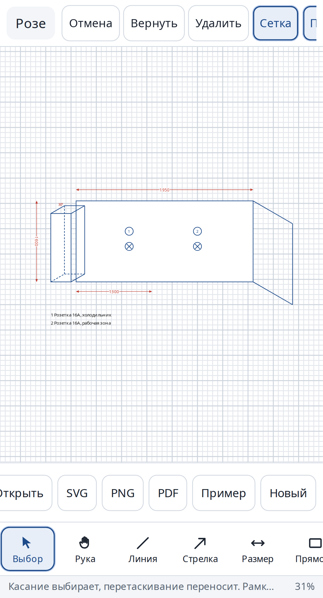
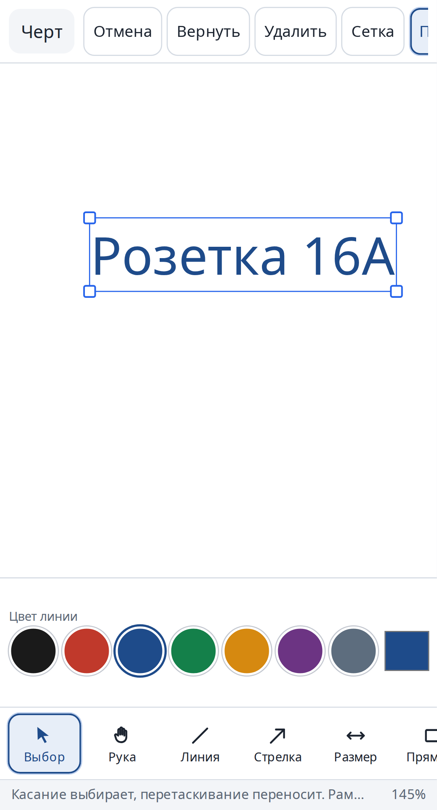
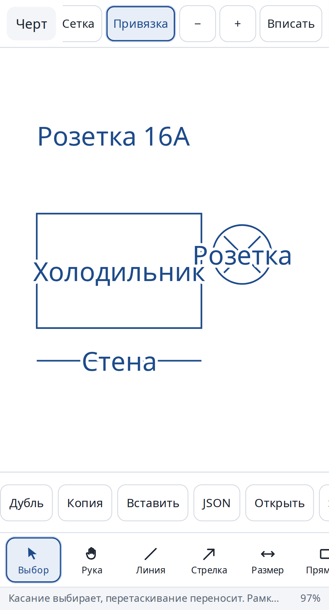
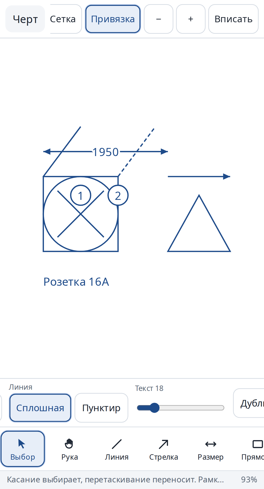
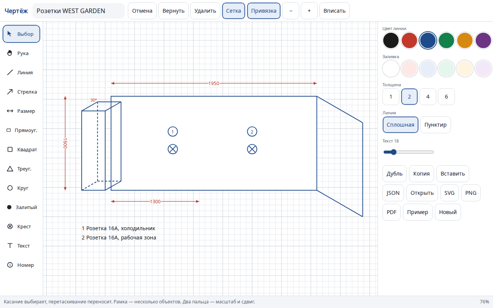

# Чертёж

Векторный редактор технических эскизов: стены в косой проекции, размерные линии, номера выносок и розетки. Всё в браузере, без сервера. Интерфейс на русском, нормально работает и с мыши, и с телефона.

**Адрес:** https://alekseichmsk.github.io/cherteg-editor/

Сайт выкладывается из ветки `main` через GitHub Actions (файл `.github/workflows/pages.yml`). После попадания изменений в `main` страница собирается сама. В настройках репозитория источник GitHub Pages должен быть **GitHub Actions**.

## Как рисовать

1. Откройте сайт. Чертёж сам сохраняется в браузере.
2. Выберите инструмент внизу (на телефоне) или слева (на компьютере). Крупные кнопки, чтобы попадать пальцем.
3. Один палец тянет линию или фигуру. Два пальца двигают лист, щипок меняет масштаб. Кнопка «Рука» — сдвиг одним пальцем. Колёсико мыши двигает лист, Ctrl+колёсико — масштаб.
4. «Привязка» цепляет конец линии к углам, концам других линий, центрам окружностей и к ближайшей точке на отрезке. Появляются направляющие: совпадение по вертикали и горизонтали, углы 0°/30°/45°/60°/90°, параллель и перпендикуляр к уже нарисованным линиям. Если вести вторую линию примерно так же, как первую, она встанет параллельно и той же длины.
5. «Сетка» включает клетку. Shift при прямоугольнике делает квадрат, при линии — шаг 45°.
6. «Размер» — линия со стрелками на обоих концах и числом по центру, повёрнутым вдоль линии. Число правится в поле «Размер» или двойным нажатием.
7. Надпись в фигуре: выделите прямоугольник, круг, треугольник, линию или стрелку и нажмите «Текст» (или дважды коснитесь). Текст стоит по центру, едет и копируется вместе с фигурой. Рамка отдельного текста совпадает с буквами.
8. «Номер» ставит кружок с номером, номер сам увеличивается. «Крест» — окружность с крестом, обозначение розетки. «Текст» на панели инструментов ставит отдельную подпись.
9. «Пунктир» нужен для невидимых рёбер. Цвет линии и заливка — палитра и своя пипетка, толщина и размер текста рядом.
10. «Выбор»: нажатие выделяет, перетаскивание двигает, рамка выделяет несколько, маркеры по краям меняют размер. Удалить, дубль, копировать и вставить, отмена и повтор — кнопками или Ctrl+Z / Ctrl+C / Ctrl+V / Ctrl+D.
11. «JSON» скачивает файл, «Открыть» загружает его обратно. «SVG», «PNG» и «PDF» (A4 или A3, книжная или альбомная) отдают чертёж на печать. В PDF линии и текст векторные, кириллица встроена. Кнопка «Пример» подставляет готовый набросок стены с розетками.

## Скриншоты

Телефон, пример плана:



Телефон, рамка выделения совпадает с текстом «Розетка 16А»:



Телефон, подписи внутри прямоугольника, розетки и на линии:



Телефон, фигуры, нарисованные инструментами (квадрат, параллельные линии, размер, розетка с крестом, номера):



Компьютер:



## Локально

Нужен любой статический сервер, модули не открываются с `file://`.

```bash
python3 -m http.server 4173
```

Проверки: `npm install`, затем `npm test` (модульные тесты и Playwright: телефон Pixel 5 и окно 1280×800).

Шрифт Noto Sans лежит в `vendor/` и распространяется по лицензии SIL Open Font License, см. `vendor/OFL.txt`.
